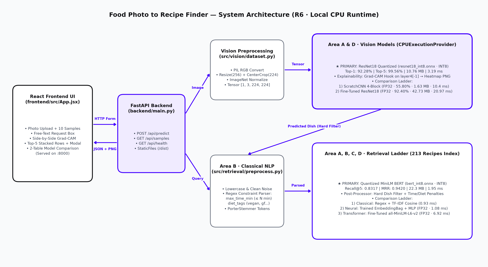
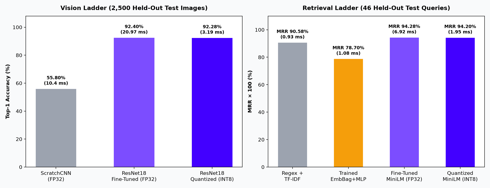

# Food Photo to Recipe Finder (SWE015 Homework · Use Case 3)

An end-to-end intelligent application that classifies a dish photo, explains what the CNN focused on via **Grad-CAM**, parses free-text dietary and preparation-time constraints, and retrieves the **Top-5 matching recipes** using **INT8 quantized ONNX models** running on CPU.



---

## 1. Quick Start (Single Run Command — Requirement R7)

The pre-built React production bundle (`frontend/dist/`) is included in the repository and served directly by FastAPI, so **Node.js is not required to run the application**.

### Setup (Windows / macOS / Linux)
```bash
# 1. Create and activate a virtual environment
python -m venv .venv
# Windows PowerShell:
.\.venv\Scripts\Activate.ps1
# macOS / Linux:
# source .venv/bin/activate

# 2. Install dependencies
pip install -r requirements.txt
```

### Single Run Command
```bash
python run.py
```
Then open **`http://127.0.0.1:8000`** in your browser (`http://127.0.0.1:8000/docs` for interactive Swagger API docs). The page opens immediately and shows a brief loading status until the models finish initializing in memory.

> **Model Weights (R7):** Large `.pt` and `.onnx` weight files are excluded from Git via `.gitignore` and hosted publicly on Hugging Face Hub (`Ahmed-Harib/food-recipe-finder-weights`). On first launch, `python run.py` automatically downloads all required weights into `./weights/`—no manual download or account needed.
> - Optional manual download: `python download_weights.py`

---

## 2. Technique Map (Requirement R2)

| Area | Required Techniques Used | Code Location |
| :--- | :--- | :--- |
| **A · Neural Networks & Deep Learning** | 4-block CNN trained from scratch (`ScratchCNN`) with BatchNorm, Dropout (`0.4`), and data augmentation; two-phase Transfer Learning & Fine-Tuning of pretrained `ResNet18`; spatial activation heatmaps via **Grad-CAM** on `layer4[-1]`; trained `EmbeddingBag + MLP` neural retrieval baseline (`NeuralDualEncoder`). | `src/vision/models.py`, `src/vision/train_cnn.py`, `src/vision/gradcam.py`, `src/retrieval/neural_retriever.py` |
| **B · Classical NLP** | Text normalization, **Regular Expression** constraint extraction (`max_time_min` e.g. `under 30 minutes`, `diet_tags` e.g. `vegetarian`, `vegan`, `gluten_free`, `dairy_free`, `spicy`, `high_protein`), **Porter Stemming**, and sublinear bigram **TF-IDF + Cosine Similarity** retrieval baseline. | `src/retrieval/preprocess.py`, `src/retrieval/tfidf_retriever.py` |
| **C · Transformers** | Subword WordPiece tokenization and fine-tuning of a BERT-based sentence encoder (`sentence-transformers/all-MiniLM-L6-v2`) with `MultipleNegativesRankingLoss` on domain `(query, recipe)` pairs. | `src/retrieval/bert_retriever.py` |
| **D · Efficient Models** | **ONNX Runtime Static INT8 Quantization** (`QuantFormat.QDQ`) of fine-tuned `ResNet18` calibrated on 120 training images; **ONNX Runtime Dynamic INT8 Quantization** of fine-tuned `MiniLM` BERT encoder; unified CPU benchmarking (`120` runs). | `src/vision/quantize_cnn.py`, `src/retrieval/quantize_bert.py`, `src/eval/benchmark.py` |

---

## 3. Measured Held-Out Benchmark Results (Requirements R3 & R4)

See [docs/benchmark_results.json](docs/benchmark_results.json) for the full JSON output measured across `2,500` held-out Food-101 test images and `46` held-out test queries over `213` recipes (`120` CPU runs after `15` warmup runs).



---

## 4. Reproducing Training, Quantization & Benchmarks From Scratch

```bash
python -m src.run_pipeline
```
Individual stages:
- `python -m src.vision.prepare_data --cleanup-raw` — Downloads `ethz/food101` and extracts the 10-class subset (`6,000` train / `1,500` val / `2,500` test).
- `python -m src.retrieval.build_recipes` — Builds `data/recipes.json` (`213` recipes) and `data/test_queries.json` (`46` test queries).
- `python -m src.vision.train_cnn` — Trains `ScratchCNN` and two-phase `ResNet18`.
- `python -m src.vision.quantize_cnn` — Exports and static-INT8-quantizes `ResNet18` to ONNX.
- `python -m src.retrieval.quantize_bert` — Exports and dynamic-INT8-quantizes fine-tuned `MiniLM` to ONNX.
- `python -m src.eval.benchmark` — Evaluates all 7 models on CPU and writes `docs/benchmark_results.json`.

---

## 5. Dataset & Reference Citations

1. **Food-101 Dataset:** Bossard, L., Guillaumin, M., & Van Gool, L. (2014). *Food-101 – Mining Discriminative Components with Random Forests*. ECCV 2014 (`ethz/food101` via Hugging Face Hub).
2. **Public Recipe Corpus:** `corbt/all-recipes` on Hugging Face Hub (`153` extracted domain recipes) supplemented with `60` constraint-tagged domain variations across the 10 dish categories (`data/recipes.json`, `213` total recipes).
3. **Pretrained Backbones:** `torchvision.models.resnet18` (ImageNet-1K) and `sentence-transformers/all-MiniLM-L6-v2` (Reimers & Gurevych, EMNLP 2019).
